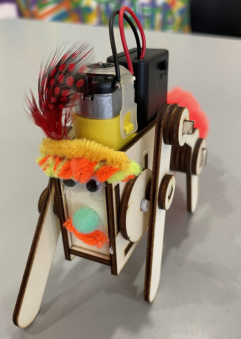
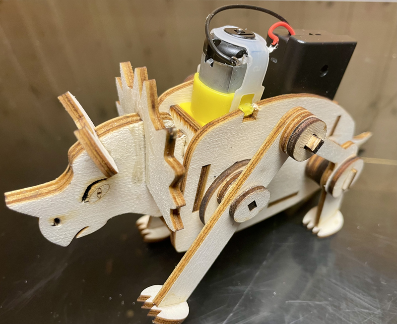
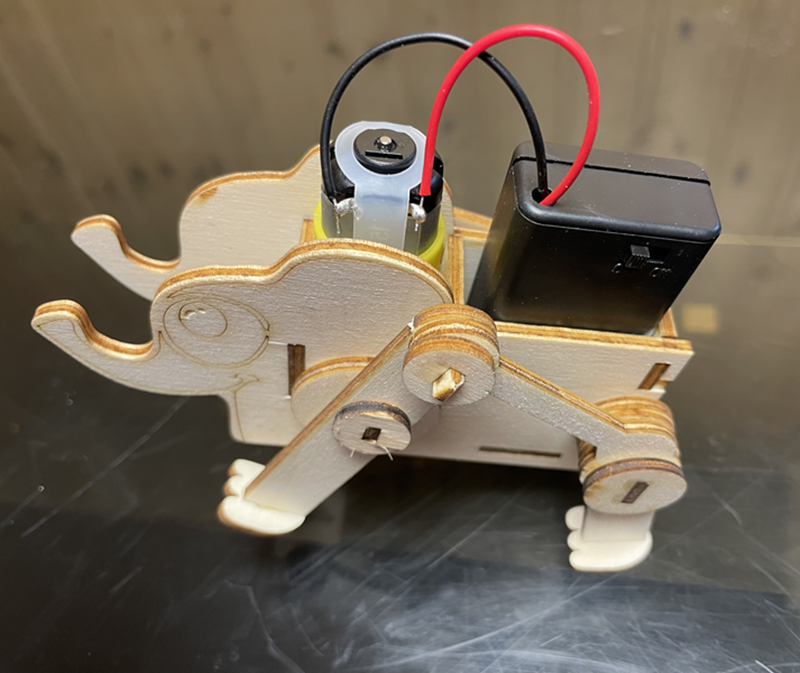
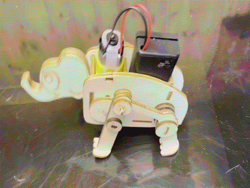
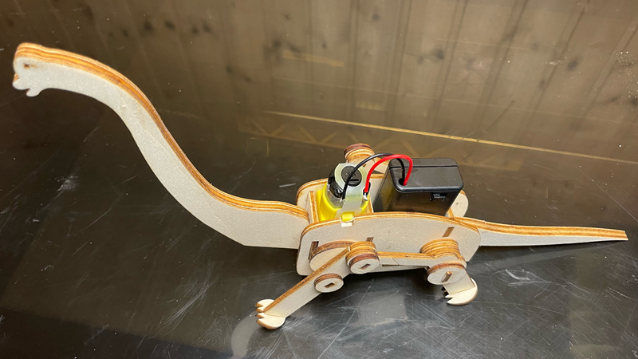
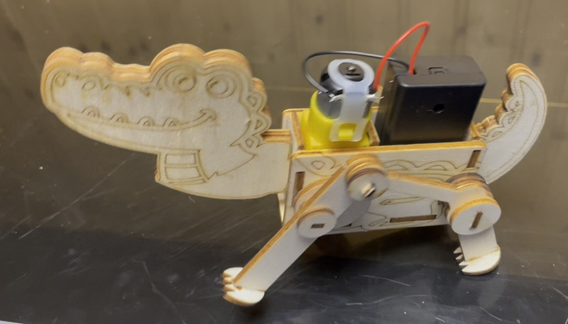
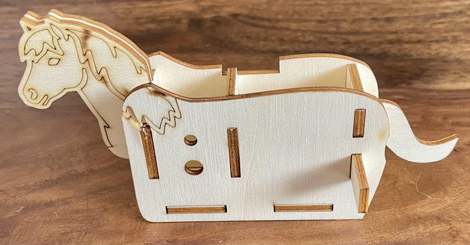
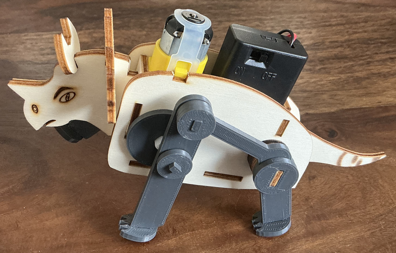

|[:skull:ISSUE](https://github.com/frankyhub/Egone/issues?q=is%3Aissue)|[:speech_balloon: Forum /Discussion](https://github.com/frankyhub/Egone/discussions)|[:grey_question:WiKi](https://github.com/frankyhub/Egone/wiki)||
|--|--|--|--|
| | | | |
<a href="https://github.com/frankyhub/Egone/issues">|<a href="https://github.com/frankyhub/Egone/discussions">|<a href="https://github.com/frankyhub/Egone/6eleases">||
|| <a href="https://github.com/frankyhub/Egone/pulse" alt="Activity">| <a href="https://github.com/frankyhub/Egone/graphs/traffic">  |<a href="https://github.com/frankyhub?tab=stars"> ||

  

  
# Egone
Little Egone Bot

 
   

# Triceratops
Little Triceratops Bot

 
   

 
   

# Jumbo
Little Jumbo Bot

 
   

 
   

# Brachiosaurus
Little Brachiosaurus Bot

 
   

# Alligator
Little Alligator Bot

 
   

# Little Ponny
Little Ponny Bot

 
   

# Egone 3D
Triceratops mit 3D-Druck Teile.

 
   

---

   
<ol class="breadcrumb" style="border-top: 2px solid black;border-bottom:2px solid black; height: 45px; width: 900px;"> 
<a href="#oben">nach oben</a>
</ol>

  

---
